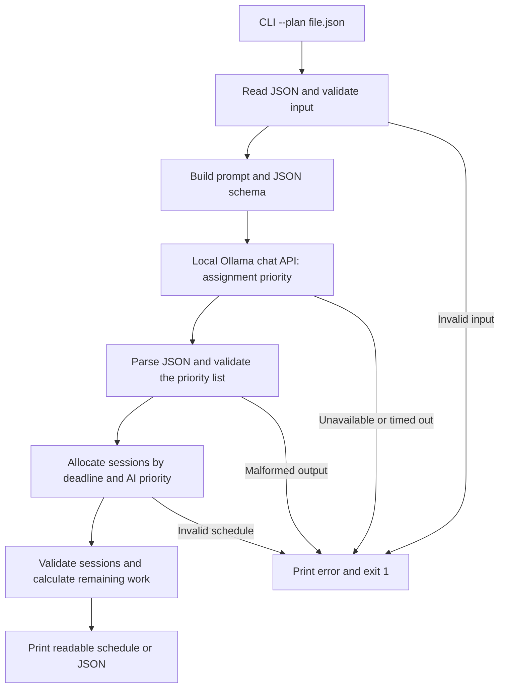

# Study Planner: Week 12 architecture

The current application has two paths. A normal text question gets a free-text model answer. A `--plan` request loads structured data, asks the model to rank assignments, and allocates sessions in application code. Earlier deadlines take precedence; the model's ranking chooses between assignments with the same deadline.

| File | Responsibility |
| --- | --- |
| `src/cli.mjs` | Parse commands, read the input file, display output and errors |
| `src/model-client.mjs` | Send an HTTP request to Ollama and validate the chat response envelope |
| `src/study-planner.mjs` | Build the priority prompt/schema, parse the model proposal, call the allocator, and format accepted plans |
| `src/plan-validation.mjs` | Validate dates, data, and the priority order; allocate sessions; enforce constraints and calculate totals |
| `scripts/live-check.mjs` | Run real-model examples and record outputs, expected totals, and timings |

For example, the synthetic normal fixture contains an AI task needing 90 minutes on November 22. The allocator splits it into 60- and 30-minute sessions on that day. Their combined 90 minutes match both the task estimate and that day's budget. Moving the second session to November 23 would violate the task's deadline. When two tasks share a deadline and there is not enough time for both, the model's order determines which receives time first.

The constrained fixture has 150 minutes of work but only 30 known available minutes. November 23 explicitly has zero minutes; November 24 has no availability record. A useful accepted plan schedules 30 minutes and reports the other 120 minutes as remaining. Missing data is reported separately from a known zero.

JSON schema constrains the model's output to an array of supplied task IDs. JavaScript also checks that every task appears exactly once. The allocator works from the original data, so the model cannot change dates, workload estimates, or availability by returning extra fields. A separate validator checks the resulting sessions and computes all totals.

Initial live tests asked the small model to generate session dates and minutes. It underallocated a 90-minute assignment and proposed work after its deadline. The recorded initial results led to the priority-list design. The final live examples check 210 scheduled minutes in the normal case and 30 scheduled/120 remaining minutes in the constrained case. These examples do not assess the semantic quality of every priority ranking or free-text study answer.

Week 13 will add model-selected `list_assignments` and `get_study_capacity` calls. In Week 12, loading a JSON file is controlled by the CLI. It is not evidence that the LLM selected a tool. Tool definitions, result messages, execution logs, and failure handling remain the next milestone.
