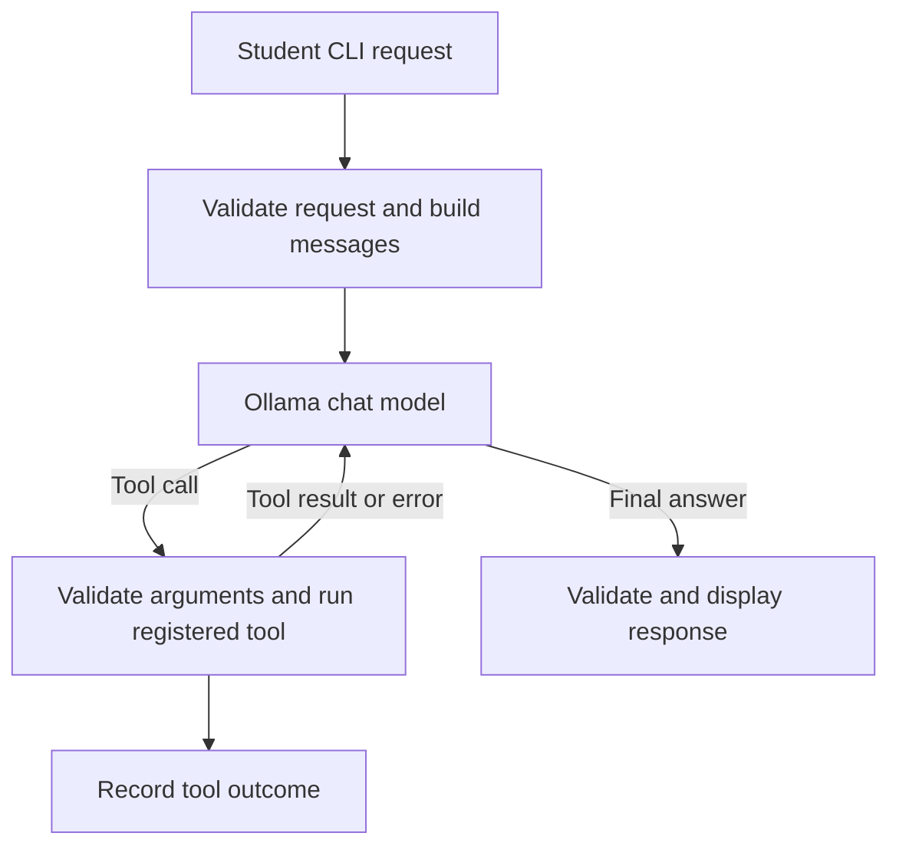

# Project Proposal — Semester Week 10

## Project Title

Study Planner Agent

## Problem Description

Students often track assignments and free study time separately. When several deadlines overlap, it is easy to plan more work than fits into the available time or overlook an upcoming assignment. This project turns task and availability data into a study plan and shows which work still needs time.

## Target Users

University students who want to prioritize coursework around deadlines and limited study time.

## Selected Difficulty

C — Intermediate. The model will decide whether to look up assignments, calculate available study time, use both tools, or answer a general question directly.

## Expected Functionality

- Answer general study-planning questions and draft a plan using deadlines and estimates supplied in the request.
- Look up upcoming assignments and calculate study capacity when the user asks about a particular date range.
- Ground plans in user input and tool results. Ask for missing information and identify any work that exceeds the available time.
- Validate tool arguments and plan output, handle unavailable data, and record tool names and outcomes for the demonstration.

## Proposed Functions

| Function | Purpose | Input | Output | Dependencies |
| --- | --- | --- | --- | --- |
| `planStudy(request)` | Answer a study-planning request and coordinate tool calls | Natural-language request | Advice or a plan with sessions and any remaining work | Model client, tool registry, plan validator |
| `complete(messages, tools)` | Send chat context and registered tool definitions to the model | Chat messages and optional tool definitions | Text and model-selected tool calls | Node.js fetch and Ollama |
| `list_assignments(start_date, end_date)` | Find assignments due within an inclusive date range | ISO calendar dates | Assignment IDs, courses, deadlines and estimated minutes | Local assignments JSON |
| `get_study_capacity(start_date, end_date)` | Retrieve available study minutes for a date range | ISO calendar dates | Daily minutes and their sum, with unknown days identified | Local availability JSON |
| `validatePlan(plan, assignments, availability)` | Check the plan against the observed data | Proposed sessions, assignments and available minutes | Validated plan or a validation error | Session schema and tool data |

## Proposed Agent Tools

- `list_assignments` supplies the actual assignment records when a student asks what is due or which work to prioritize.
- `get_study_capacity` supplies time constraints when a student asks how much study time is available or whether their work fits.

Both tools read local data. The program will validate dates, reject calls outside the registered tools, and return tool results or a clear error to the model.

## Model Selection

Use Qwen3 4B through Ollama's local chat API. Qwen3 supports tool calling, and the local setup lets the prototype run without an API key. Use synthetic assignment and availability data in development and the demo.

## Architecture

## Example Requests

1. “Which assignments are due from November 16 to November 22, 2026?”
2. “Plan my assignments for November 16–22, 2026 around my available study time. Tell me if any work won't fit.”
3. “How much study time do I have from November 16 to November 18, 2026?”
4. “How should I break a two-hour reading session into shorter blocks?”

## Evaluation Plan

Use fixed local data to test assignment lookup, capacity totals, a plan using both tools, a general question without tools, invalid dates, unknown dates, over-capacity work, and model or tool failure. Use simulated responses for repeatable application tests and then run the example requests with the actual model. Compare dates and totals with the fixture, verify the tool trace, and record mismatches and latency.

## Weekly Milestones

| Week | Planned work |
| --- | --- |
| 10 | Proposal and architecture draft. The draft was prepared in Week 11. |
| 11 | Implement the CLI and Ollama adapter. Verify one live request when the model is available. |
| 12 | Define the session output and validate time totals. Create the local fixtures. |
| 13 | Register the two tools, validate their dates, and return real results to the model. |
| 14 | Exercise direct answers and multi-tool requests. Add trace output and handling for missing data. |
| 15 | Add tests for invalid arguments, malformed plans, and service failures. |
| 16 | Run the evaluation suite and live examples, record the results, and address failures. |
| 17 | Finalize documentation and report, submit the final commit, and defend the implementation. |

## AI Assistance

Codex assisted with drafting this proposal and implementing and testing the initial prototype.
